# 📁 File Management System

A full-stack file management platform built with React, Node.js, Express, and MySQL, designed specifically for organizing, managing, and searching **PDF documents and images (JPG, JPEG, PNG)**. The system features secure JWT authentication, role-based access control (Admin/User), hierarchical folder structures, and OCR-powered document text extraction using Tesseract.js. Users can upload documents, preview files, search across extracted text content, and toggle light/dark mode in a modern responsive UI.

---

## 📸 Screenshots & UI Preview

> *All application screenshots are located in [`docs/media/`](docs/media/). Below is the visual gallery showing both Admin and User perspectives across Light and Dark themes:*

### 1. Authentication & Onboarding
| **Login Page** | **Account Registration** |
|:---:|:---:|
| 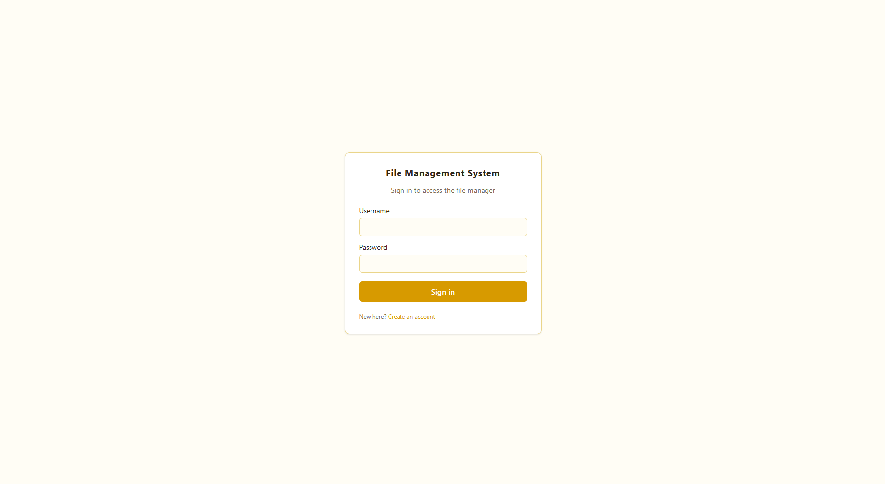 | 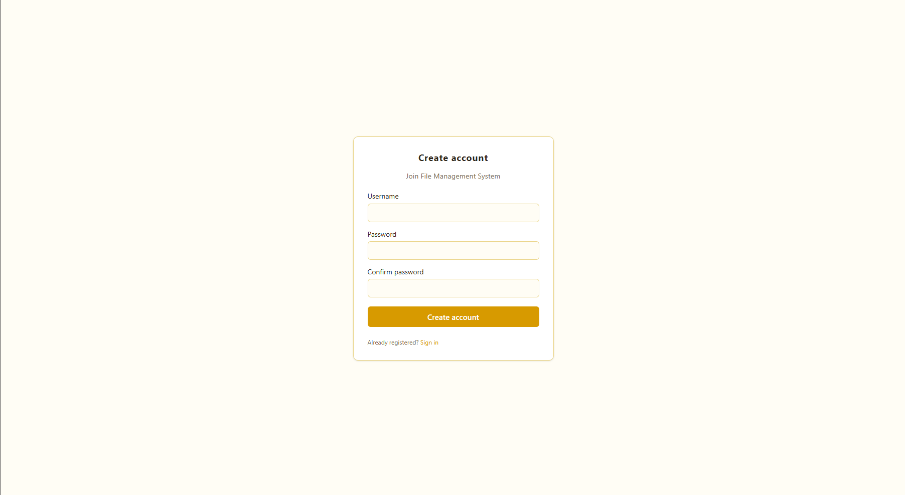 |
| **`login.png`**<br>Secure entry point with username/password authentication, JWT cookie issuance, and validation feedback. | **`register.png`**<br>User self-registration form with password confirmation to join the system. |

### 2. Admin Dashboard & File Management
| **Admin Dashboard — Light Mode (Icon View)** | **Admin Dashboard — Light Mode (List View)** |
|:---:|:---:|
| 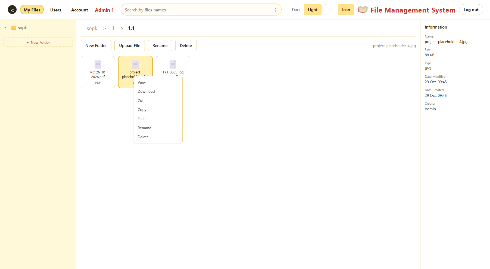 | 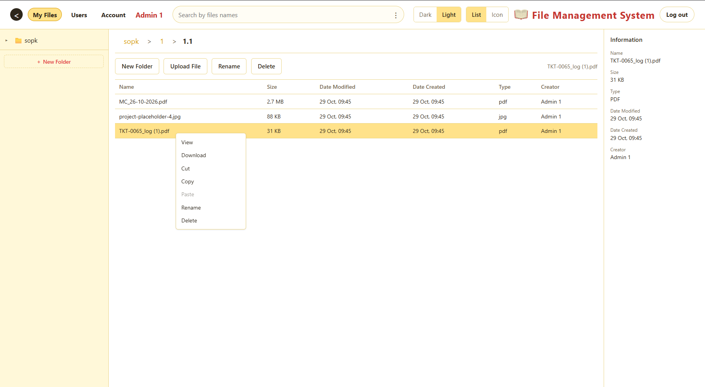 |
| **`admindashboard-light-icon.png`**<br>Grid view showing folders and file cards, with contextual menu for View, Download, Cut, Copy, Rename, and Delete operations. | **`admindashboard-light-list.png`**<br>Detailed table view with breadcrumbs, multi-select capability, file metadata (size, dates, type, creator), and top action toolbar. |

| **Admin Dashboard — Dark Mode View** |
|:---:|
| 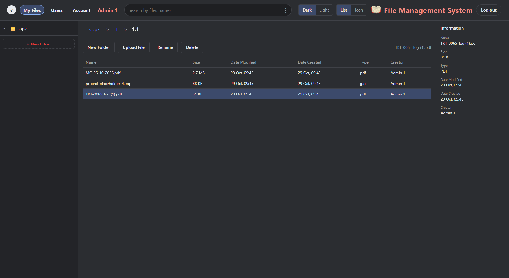 |
| **`admindashboard-dark.png`**<br>High-contrast dark theme mode displaying the collapsible left folder tree navigation, active directory path, and administration controls. |

### 3. User (Viewer) Experience
| **User Dashboard — Icon View** | **User Dashboard — List View** |
|:---:|:---:|
| 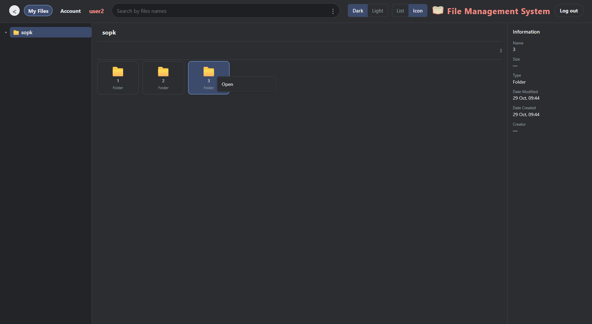 | 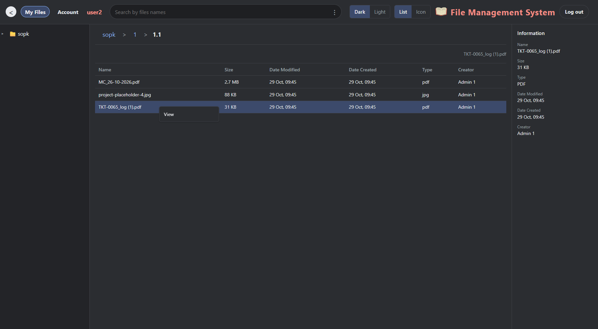 |
| **`user-dashboard-icon.png`**<br>Role-based view for standard users: clean browsing interface with creation/deletion controls automatically hidden. | **`user-dashboard-list.png`**<br>Tabular document view for standard users with instant file preview and safe download access. |

### 4. Search & OCR Document Intelligence
| **Standard File Search Results** | **Advanced OCR Content Search Modal** |
|:---:|:---:|
| 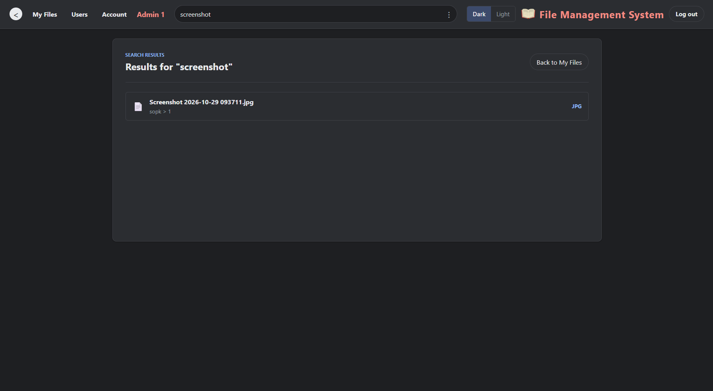 | 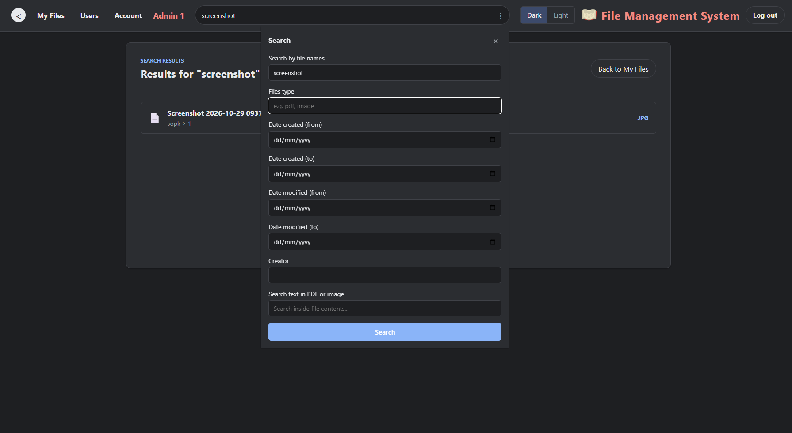 |
| **`admin-search-normal.png`**<br>Instant keyword search displaying matched documents with file type badges and direct navigation links. | **`admin-search-in-content.png`**<br>Deep OCR text search modal allowing users to query text extracted directly from scanned PDFs and images, with date range, creator, and type filters. |

### 5. Administration & Account Settings
| **User Management Console** | **Account Profile Settings** |
|:---:|:---:|
| 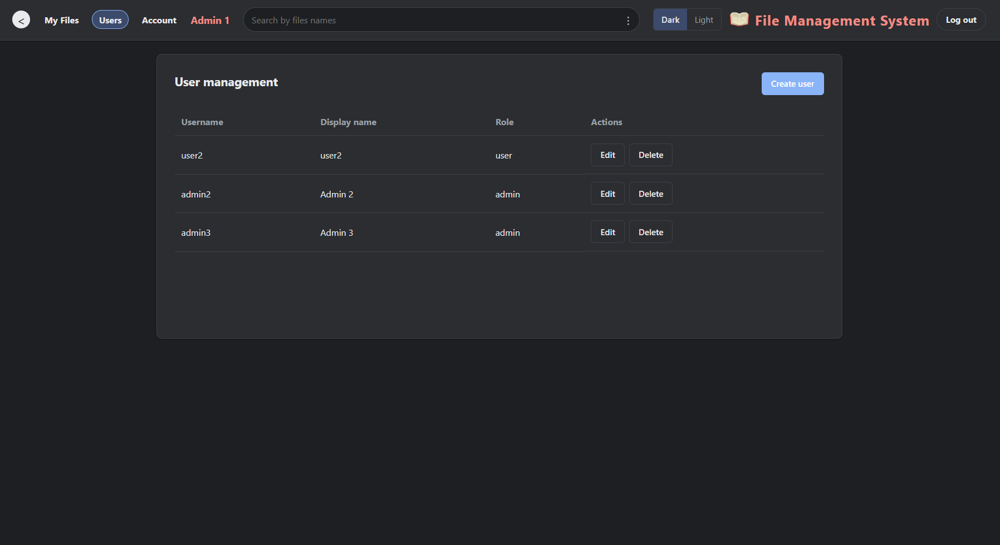 | 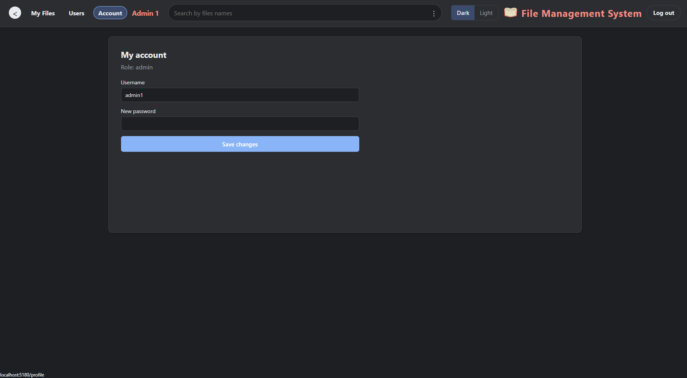 |
| **`admin-userlist.png`**<br>Administrator management dashboard to inspect all registered users, edit display names, assign roles (`admin` / `user`), and remove accounts. | **`admin-account-profile.png`**<br>User account preferences page showing current role badge and secure password update form. |

---

## ✨ Features

- **📄 Dedicated Format Support** — Specifically tailored for **PDF documents** and **Images (JPG, JPEG, PNG)**.
- **🧠 OCR Text Extraction** — Automatically extracts text from uploaded PDFs and images via Tesseract.js and pdf-parse for indexed search.
- **🔍 Full-Text Content Search** — Instantly search documents not just by filename, but by extracted text content.
- **🔐 Secure Authentication** — JWT authentication with HTTP-only cookies and role-based access control (Admin & User roles).
- **📂 Hierarchical Folder Management** — Create, rename, move, and organize folders with breadcrumb navigation.
- **📑 File Operations** — Upload, preview, download, rename, and soft-delete files with drag-and-drop support.
- **👥 Admin User Management** — Dedicated admin panel to create, view, update, and manage user accounts and privileges.
- **🌗 Light & Dark Theme** — Persistent theme toggle with smooth transitions across all pages.
- **📊 Grid & List Views** — Toggle between visual grid view and detailed table list view.

---

## 🛠️ Supported File Types

| File Type | Extensions | Supported Capabilities |
|---|---|---|
| **PDF Documents** | `.pdf` | Upload, Preview, Download, Text Parsing (`pdf-parse`) & OCR (`Tesseract.js`) |
| **Image Files** | `.jpg`, `.jpeg`, `.png` | Upload, Thumbnail Preview, High-Res Viewer, Optical Character Recognition (OCR) |

---

## 🛠️ Tech Stack

### Frontend
| Technology | Purpose |
|---|---|
| **React 19** | Modern UI component architecture |
| **React Router v7** | Client-side routing & protected routes |
| **Vite 8** | High-performance build tool & dev server |
| **CSS Modules** | Scoped, modular, and maintainable styling |

### Backend
| Technology | Purpose |
|---|---|
| **Node.js** | Server runtime environment |
| **Express.js** | Modular REST API routing & middleware |
| **MySQL** | Relational database storage |
| **JWT & bcryptjs** | Authentication, secure cookies & password hashing |
| **Multer** | Multipart form & file upload handling |
| **Tesseract.js** | OCR engine for image and scanned PDF text extraction |
| **pdf-parse** | Digital PDF document text parser |

---

## 📦 Project Structure

```
file-management-system/
├── docs/
│   └── media/               # UI preview screenshots for GitHub & documentation
├── frontend/                # React + Vite frontend
│   ├── src/
│   │   ├── components/      # UI components (Header, Sidebar, FileList, Modals)
│   │   ├── context/         # AuthContext & ThemeContext
│   │   ├── hooks/           # Custom React hooks
│   │   ├── pages/           # Pages (LoginPage, FileManager, Search, AdminUsers)
│   │   ├── services/        # Axios API clients
│   │   ├── styles/          # CSS modules
│   │   └── utils/           # Helper utilities
│   └── index.html
├── backend/                 # Express API server
│   ├── config/              # DB connection & env configurations
│   ├── controllers/         # Auth, File, Folder, and User controllers
│   ├── database/            # SQL schemas & seed queries
│   │   ├── schema.sql       # Database table definitions
│   │   └── seed_admins.sql  # Seed script for admin accounts
│   ├── middleware/          # JWT auth & error handling
│   ├── routes/              # Express API route endpoints
│   ├── scripts/             # Database initialization script
│   ├── uploads/             # Storage folder for uploaded files
│   └── server.js            # Main Express entry point
└── README.md
```

---

## 🚀 Getting Started

### Prerequisites

- **Node.js** v18+
- **MySQL** v8.0+
- **npm** or **yarn**

### 1. Clone the Repository

```bash
git clone https://github.com/your-username/file-management-system.git
cd file-management-system
```

### 2. Backend Setup

```bash
cd backend
npm install
```

Configure `.env` in `backend/`:

```env
PORT=4000
NODE_ENV=development

DB_HOST=localhost
DB_PORT=3306
DB_USER=root
DB_PASSWORD=your_password
DB_NAME=file_management_system

JWT_SECRET=your_jwt_secret_key
JWT_EXPIRES_IN=7d

CLIENT_ORIGIN=http://localhost:5180
UPLOAD_DIR=uploads
```

Initialize the database schema:

```bash
npm run db:setup
```

*(Optional)* Run the admin seed query to add the 3 admin accounts:
```bash
mysql -u root -p file_management_system < database/seed_admins.sql
```

Start the backend:

```bash
npm run dev
```

### 3. Frontend Setup

```bash
cd ../frontend
npm install
```

Configure `.env` in `frontend/`:

```env
VITE_BACKEND_URL=http://localhost:4000
VITE_API_BASE_URL=/api
VITE_DEV_HOST=0.0.0.0
VITE_DEV_PORT=5180
```

Start Vite dev server:

```bash
npm run dev
```

Visit: `http://localhost:5180`

---

## 🔑 Default Accounts & Seed Credentials

### Initial Default Accounts (from `npm run db:setup`):
| Role | Username | Password |
|---|---|---|
| Admin | `admin` | `admin` |
| Viewer | `viewer` | `viewer` |

### Additional Admin Seed Accounts (`database/seed_admins.sql`):
| Role | Username | Password |
|---|---|---|
| Admin | `admin1` | `admin1123` |
| Admin | `admin2` | `admin2123` |
| Admin | `admin3` | `admin3123` |

---

## 📡 API Endpoints Summary

| Method | Route | Description |
|---|---|---|
| `POST` | `/api/auth/login` | Authenticate user & issue JWT cookie |
| `POST` | `/api/auth/register` | Register new user account |
| `POST` | `/api/auth/logout` | Clear auth token cookie |
| `GET` | `/api/auth/me` | Fetch active user session |
| `GET` | `/api/users` | List all users *(Admin only)* |
| `PATCH` | `/api/users/:id` | Update user role / details *(Admin only)* |
| `DELETE` | `/api/users/:id` | Remove user *(Admin only)* |
| `GET` | `/api/folders` | Retrieve folder tree |
| `POST` | `/api/folders` | Create new folder |
| `PATCH` | `/api/folders/:id` | Rename / move folder |
| `DELETE` | `/api/folders/:id` | Delete folder |
| `GET` | `/api/files` | Get files in folder |
| `POST` | `/api/uploads` | Upload PDF / image & run OCR extraction |
| `GET` | `/api/files/:id/download`| Download original file |
| `GET` | `/api/files/search` | Search files by name & OCR text content |

---

## 📄 License

Distributed under the [MIT License](LICENSE).
